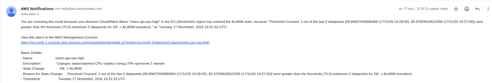
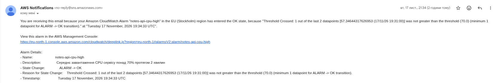

# Сповіщення

## Умова і обґрунтування
Правило `terraform/alerts.tf`: `notes-api-cpu-high`, метрика `AWS/ECS CPUUtilization` (середнє по сервісу), **понад 70% протягом 2 хвилин** (період 60 с, 2 точки з 2), `treat_missing_data = notBreaching`. Канал: SNS-тема з email-підпискою. Перехід у стан ALARM (`alarm_actions`) і повернення в OK (`ok_actions`) відправляють лист у ту саму тему.

Чому 70% і 2 хвилини:
- Цільове значення масштабування 60%, тому 70% означає, що автоматика вже не встигає: це привід повідомити людину.
- Умова «протягом 2 хвилин» (а не одна точка) відсікає короткі сплески, на які реагувати не варто, і зменшує кількість зайвих листів.

**Нестабільне спрацьовування (flapping)** це коли метрика ходить навколо порога, і тривога постійно перемикається ALARM ↔ OK, засипаючи пошту. Вимога «2 точки поспіль» цю проблему зменшує. У прогоні без кешу це видно на фактичних даних: у точці 19:31 CPU впав до 57,3% (лист OK), а наступної хвилини знову піднявся до ≈ 80%. Повторної тривоги не було, бо для переходу в ALARM потрібні дві точки поспіль, а така точка була одна.

## Листи (прогін без кешу, N = 150)

Лист про тривогу (OK → ALARM), 19:31:33 UTC:

Лист про повернення до норми (ALARM → OK), 19:34:33 UTC:

Під час прогону з кешем сповіщення спрацювали так само (22:02:49 і 22:06:49 UTC): [тривога](img/alert-alarm-run2.png), [повернення до норми](img/alert-ok-run2.png). На знімках прибрано рядки з ідентифікатором акаунта AWS і адресою пошти.

## Час реакції

| Подія | Без кешу (UTC) | З кешем (UTC) |
|---|---|---|
| Початок навантаження | 19:25:24 | 21:56:57 |
| Початок сталої фази | 19:28:24 | 21:59:57 |
| Перші точки CPU > 70% (з тексту листа) | 19:27 (99,4%), 19:28 (99,8%) | 21:58 (95,9%), 21:59 (99,7%) |
| **Лист про тривогу** | **19:31:33** | **22:02:49** |
| Лист про повернення до норми | 19:34:33 (точка 19:31 = 57,3%) | 22:06:49 (точка 22:03 = 49,9%) |
| Кінець навантаження | 19:35:24 | 22:06:57 |

Виміряні інтервали:

| Інтервал | Без кешу | З кешем |
|---|---|---|
| Від початку навантаження до листа про тривогу | 6 хв 09 с | 5 хв 52 с |
| Від початку **сталої фази** до листа про тривогу | 3 хв 09 с | 2 хв 52 с |
| Від початку першої хвилини з CPU > 70% до листа | 4 хв 33 с | 4 хв 49 с |
| Від листа про тривогу до листа про норму | 3 хв | 4 хв |

З яких складових формується затримка: тривога потребує двох хвилинних точок поспіль вище порога (мінімум 2 хв); до цього додаються запізнення публікації метрики ECS у CloudWatch, сама оцінка тривоги і доставка через SNS. Окремо я ці складові не вимірював, тому наведені лише сумарні інтервали.

Спостереження: лист про тривогу прийшов приблизно тоді ж, коли автомасштабування вже збільшило бажану кількість екземплярів (близько 19:30:30 і близько 22:03). Обидві реакції залежать від однієї метрики, тож сповіщення не випереджає автоматику.

Лист про повернення до норми прийшов ще до кінця навантаження, бо після появи нових екземплярів середнє CPU впало нижче 70%.

Чи прийнятний час реакції: близько 3–5 хвилин від початку проблеми до листа цілком прийнятні для сповіщення про зростання навантаження, коли сервіс ще працює. Для критичних збоїв (недоступність сервісу) цього замало. Для них потрібна тривога на 5xx або на `UnHealthyHostCount`, а також канал з миттєвою доставкою замість пошти.
