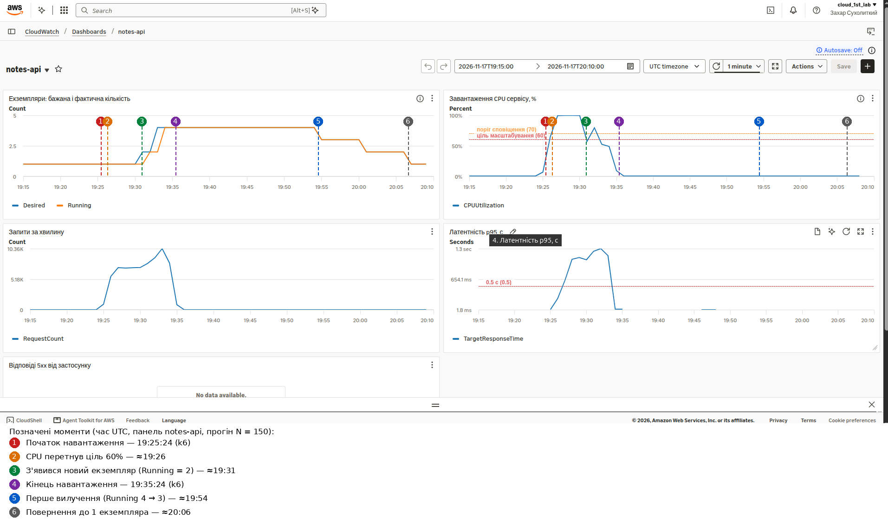

# Автоматичне масштабування і моніторинг

## Параметри політики (завдання 1)

Ресурси: `terraform/autoscaling.tf` (`aws_appautoscaling_target`, `aws_appautoscaling_policy`, тип `TargetTrackingScaling`).

| Параметр | Значення | Обґрунтування |
|---|---|---|
| min / max екземплярів | 1 / 4 | Мінімум 1 дозволяє не платити за простій; максимум 4 це ліміт лаби. Є й технічна причина: кожен екземпляр відкриває до 15 з'єднань до RDS (`pool_size=10`, `max_overflow=5`), на 4 екземпляри це до 60 з'єднань, а `db.t4g.micro` дозволяє близько 100. |
| метрика | `ECSServiceAverageCPUUtilization` | Запити до нотаток тримають процесор зайнятим (серіалізація JSON, робота з пулом), тому CPU добре відображає навантаження. Для сервісу, що в основному чекає на базу, краща метрика `ALBRequestCountPerTarget`. |
| цільове значення | 60% | Запас 40% потрібен через те, що новий екземпляр з'являється лише через кілька хвилин: за цей час навантаження ще зростає. Якщо поставити 90%, запасу не буде, і латентність погіршиться ще до масштабування. 30% змусило б тримати зайві екземпляри без потреби. |
| `scale_out_cooldown` | 60 с | Додавати можна швидко: поки екземпляр не додано, користувачі вже страждають. |
| `scale_in_cooldown` | 300 с | Прибирати слід обережно: після короткого спаду навантаження може повернутись, а повторний запуск екземпляра дорогий за часом. |

## Що таке cooldown і що буде при 0

Cooldown (період стабілізації) це пауза після масштабування, протягом якої політика не виконує нову дію в тому ж напрямку. Вона потрібна, бо результат попередньої дії ще не відобразився в метриці: новий екземпляр стартує кілька хвилин, а середнє CPU ще рахується без нього.

При `cooldown = 0` політика може додавати екземпляри кожну хвилину, не чекаючи, чи допомогло попереднє додавання. Це призводить до перевитрат (надмірна кількість екземплярів) і до «гойдалки»: екземпляри додаються, CPU різко падає, їх вилучають, і навантаження знову зростає. Для вилучення нульовий cooldown ще небезпечніший: короткий спад навантаження призвів би до швидкого скорочення, і наступний сплеск застав би сервіс зі зменшеною потужністю.

## Панель моніторингу (завдання 3)

Прогін: N = 150 користувачів, наростання 3 хв, стала фаза 5 хв, спад 2 хв. Усі часи нижче в UTC (Київ = UTC+2).

| № | Момент | Час | Джерело |
|---|---|---|---|
| 1 | Початок навантаження | 19:25:24 | вивід k6 |
| 2 | CPU перетнув ціль 60% | ≈ 19:26 | графік CPU |
| 3 | З'явився новий екземпляр (Desired = 2 близько 19:30:30, Running = 2 близько 19:31) | ≈ 19:31 | графік екземплярів |
| 4 | Кінець навантаження | 19:35:24 | вивід k6 |
| 5 | Перше вилучення (Running 4 → 3) | ≈ 19:54 | графік екземплярів |
| 6 | Повернення до 1 екземпляра | ≈ 20:06 | графік екземплярів |

Стала фаза тривала 19:28:24–19:33:24. Масштабування до 4 екземплярів відбулось саме під час неї (Desired = 4 близько 19:33, Running = 4 близько 19:34).

Спостереження за графіками:
- З початку навантаження до появи нових екземплярів CPU був на 100% протягом приблизно 3 хвилин, а p95 піднявся до ≈1,3 с, вище лінії 0,5 с.
- Кількість запитів за хвилину впиралась у стелю близько 7 тис. (межа одного екземпляра), а після появи нових зросла до 10,4 тис.
- Відповідей 5xx від застосунку на панелі немає (No data).

### Чому між перетином порогу і появою екземпляра минає час

Від перетину 60% (≈ 19:26) до появи нового екземпляра (≈ 19:31) минуло близько 4–5 хвилин. Затримка складається з кількох частин:

1. **Метрика.** CloudWatch отримує CPU раз на хвилину і з невеликим запізненням.
2. **Рішення.** Політика target tracking створює тривогу, яка спрацьовує лише тоді, коли метрика вища за ціль кілька хвилинних точок поспіль (3 за документацією AWS). Це захист від короткочасних сплесків.
3. **Запуск.** Після рішення (Desired) Fargate має виділити ресурси, завантажити образ з ECR, запустити контейнер. Далі ALB перевіряє `/health` з інтервалом 15 с і чекає двох успішних перевірок (`healthy_threshold = 2`), тільки тоді екземпляр отримує трафік. На графіку це видно як відставання лінії Running від Desired приблизно на хвилину.

### Чому вилучення відбувається значно пізніше за падіння навантаження

Навантаження закінчилось о 19:35:24, а перший екземпляр вилучено близько 19:54, тобто через ≈19 хвилин. До 1 екземпляра сервіс повернувся лише близько 20:06, тобто через ≈31 хвилину:

1. **Тривога на зниження.** Для вилучення AWS створює окрему тривогу, яка вимагає, щоб метрика була нижче цілі близько 15 хвилин поспіль. Це зроблено навмисно: простій екземпляр коштує копійки, а нестача потужності призводить до помилок і повільних відповідей.
2. **`scale_in_cooldown = 300 с`.** Після кожного вилучення політика чекає 5 хвилин. На графіку це видно як три сходинки 4 → 3 → 2 → 1 приблизно по 5 хвилин кожна.
3. **Дообробка запитів.** Екземпляр, що вилучається, спершу виводиться з ALB: для нього діє `deregistration_delay = 30 с` (за замовчуванням 300), під час якого ALB не відправляє нових запитів, але дає завершитись поточним. Потім ECS надсилає контейнеру SIGTERM, uvicorn виконує graceful shutdown (дообробляє поточні запити і закриває з'єднання з базою), а якщо контейнер не вийшов за `stopTimeout = 30 с`, його зупиняють примусово.

### Що можна покращити
У цьому прогоні масштабування запізнилось: 3 хвилини CPU на 100%. Варіанти: знизити ціль до 40–50%, перейти на метрику `ALBRequestCountPerTarget`, збільшити задачу (CPU 512), тримати `min_tasks = 2`.
