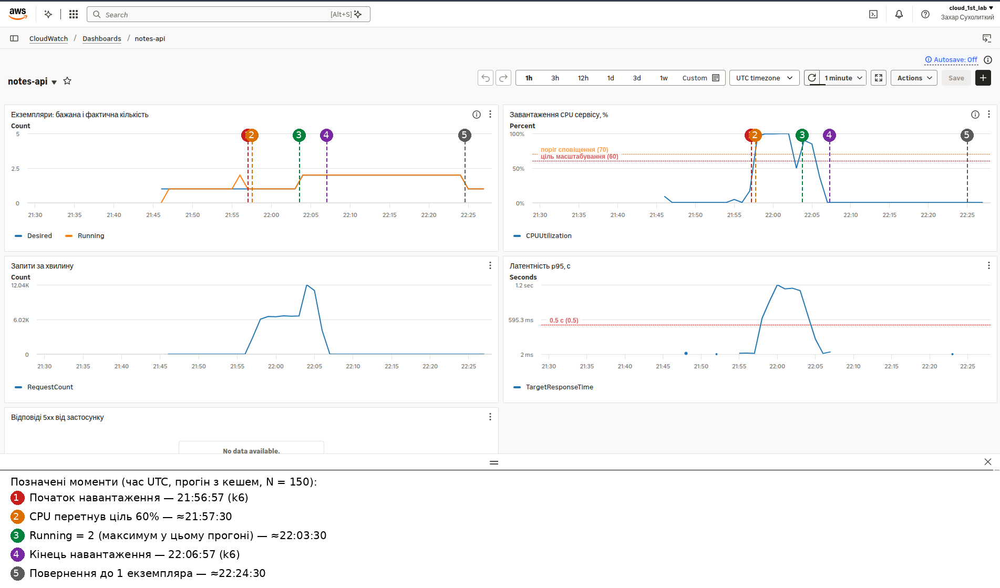

# Кешування

## Реалізація
Кешується `GET /notes` (список останніх 100 нотаток): його відповідь найбільша (≈ 30 КБ), а у сценарії це третина всіх читань. Схема cache-aside (`app/main.py`):

1. сервіс перевіряє Redis за ключем `notes:list`;
2. якщо дані є, повертає їх (готовий JSON, без звернення до бази й повторної серіалізації);
3. якщо немає, читає з бази, кладе в Redis з терміном дії `CACHE_TTL` (30 с) і повертає.

Redis: Amazon ElastiCache (`cache.t4g.micro`, один вузол) у приватних підмережах, доступ лише з security group застосунку (`terraform/cache.tf`). Якщо Redis недоступний, сервіс працює як без кешу (таймаут 0,3 с, помилки перехоплюються). Один вузол це єдина точка відмови для кешу, але не для сервісу.

Кеш керується змінними середовища (`CACHE_ENABLED`, `CACHE_TTL`, `CACHE_INVALIDATE`), тому той самий образ використовується для прогонів з кешем і без. Лічильники влучань і промахів зберігаються в Redis, тому спільні для всіх екземплярів і доступні через `GET /stats`.

### Чому кеш у пам'яті процесу не підходить
Якщо кешувати у змінній процесу, кожен екземпляр матиме власну копію. Клієнт міг би бачити різні версії списку залежно від того, на який екземпляр потрапив запит, а після запуску нового екземпляра його кеш порожній. Кількість звернень до бази зростала б разом із кількістю екземплярів. Спільний Redis розв'язує це: усі екземпляри читають і пишуть в одне сховище.

## Результати (однаковий сценарій, N = 150)

| Показник | Без кешу | З кешем (TTL 30 с) |
|---|---|---|
| p50 латентності | 465 мс | 492 мс |
| p95 латентності | 1,13 с | 1,09 с |
| p99 латентності | 1,48 с | 1,32 с |
| Запитів за секунду (середнє за тест) | 117,7 | 114,3 |
| Пік запитів за хвилину (панель) | ≈ 10,4 тис. | ≈ 12,0 тис. |
| Максимум екземплярів | 4 | 2 |
| Запитів списку до БД | ≈ 21 243 (розрахунково: кожен `GET /notes` це один запит) | 76 (лічильник промахів) |
| Частка влучань | не застосовується | **99,63%** (20 658 влучань з 20 734) |
| Зміна лічильників БД за тест (`GET /stats`) | не знімалась | `xact_commit` +62 424; `tup_returned` +7 810 264; `tup_fetched` +6 047 619 |

Знімок панелі прогону з кешем (максимум 2 екземпляри):

Короткий сплеск Running = 2 близько 21:56 не є масштабуванням: CPU в цей час майже нульовий, найімовірніше це завершення оновлення сервісу перед тестом. Після кінця навантаження до 1 екземпляра сервіс повернувся близько 22:24:30 (≈ 17 хв).

### Аналіз
- **Навантаження на базу значно зменшилось:** запитів списку до БД стало 76 замість приблизно 21 тисячі (≈ −99,6%). Частка влучань 99,63%.
- **Латентність майже не змінилась** (p95 1,13 с проти 1,09 с, p50 навіть трохи гірша). Причина в тому, що вузьким місцем у цьому сценарії був процесор екземплярів, а не база: в обох прогонах CPU майже 3 хвилини був на 100%, поки не з'явились нові екземпляри. Кеш прибирає з бази запит списку, але не прибирає решту роботи застосунку.
- **Видимий ефект кешу це економія ресурсів:** автомасштабування дійшло лише до 2 екземплярів замість 4, а пік пропускної здатності на панелі не нижчий (≈ 12,0 тис. запитів на хвилину проти ≈ 10,4 тис.). Це лише одиничні прогони, а до 2 екземплярів масштабування дійшло ще й тому, що навантаження вже спадало, коли з'явився другий екземпляр. Тому твердити, що кеш удвічі зменшив потрібну потужність, не можна.
- **Що ще впливає на цифри `/stats`:** основна частина `tup_returned` (≈ 7,8 млн) імовірно припадає на запит `GET /authors/{name}`, який рахує нотатки автора й читає тим більше рядків, чим більше нотаток у таблиці. Кеш цього запиту не торкається. Це гіпотеза, її можна перевірити через `EXPLAIN ANALYZE`. Наступний крок оптимізації: кешувати або денормалізувати цей лічильник.
- **Промахи:** за 10 хвилин при TTL 30 с очікувалось близько 20 промахів, а було 76. Причина в тому, що кілька запитів одночасно не знаходять ключ після завершення його терміну і всі йдуть у базу, перш ніж перший з них заповнить кеш (cache stampede). Способи боротьби: блокування на час оновлення, випадкове відхилення TTL, фонове оновлення перед закінченням терміну.

### Обмеження вимірювань
- Кожен варіант прогнано один раз.
- Для прогону без кешу лічильники `/stats` не знімались, тому порівняння навантаження на базу спирається на розрахунок кількості запитів списку, а не на вимірювання.
- Початковий стан бази відрізнявся: перед прогоном з кешем лічильники БД були майже нульові (схоже, база була створена заново), тому таблиця нотаток була меншою, ніж перед прогоном без кешу.

## Актуальність даних
У налаштуванні TTL без інвалідації клієнт може бачити застарілий список до `CACHE_TTL` = 30 секунд після запису: нова нотатка з'явиться в списку, коли закінчиться термін дії ключа. Окремі нотатки (`GET /notes/{id}`) не кешуються, тому показують дані без затримки.

Щоб скоротити час застарівання, є два шляхи:
- **Менший TTL.** Простіше, але більше промахів і більше навантаження на базу.
- **Інвалідація при записі** (`CACHE_INVALIDATE=true`: видалення ключа при `POST` і `DELETE`). Дані майже завжди свіжі, але при частих записах кеш постійно скидається, і частка влучань падає. У нашому сценарії це 1 запис на 9 читань від кожного користувача, тобто інвалідація відбувалась би дуже часто. Цей варіант я не вимірював.
